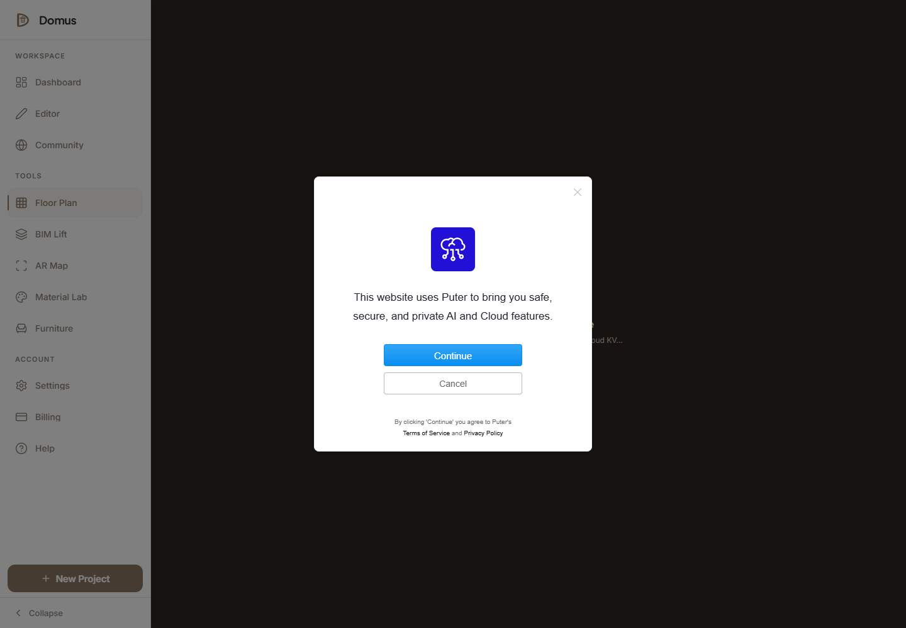
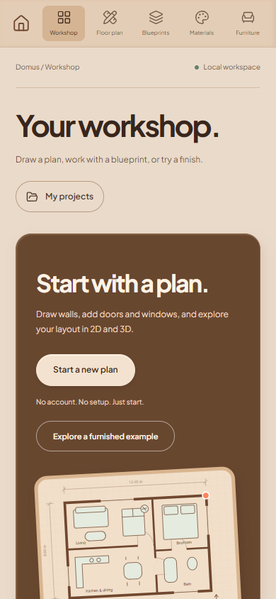
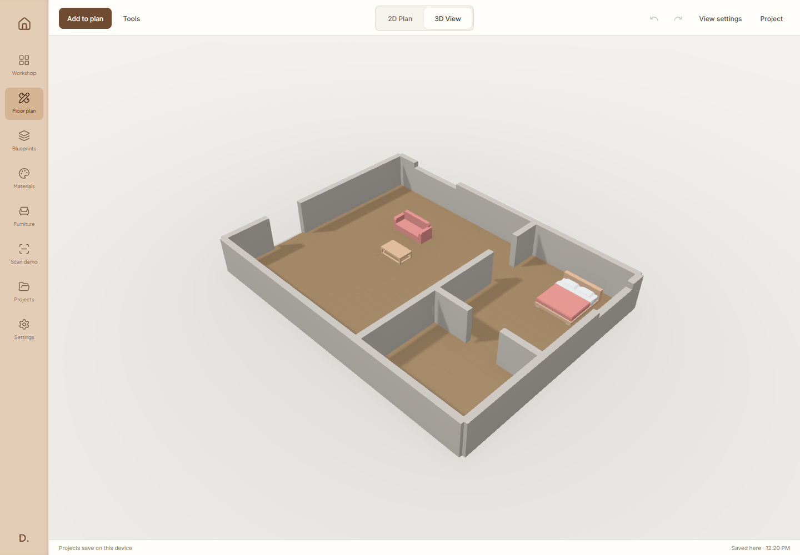
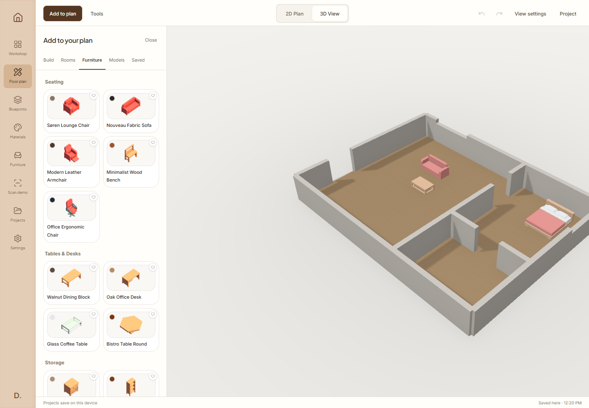
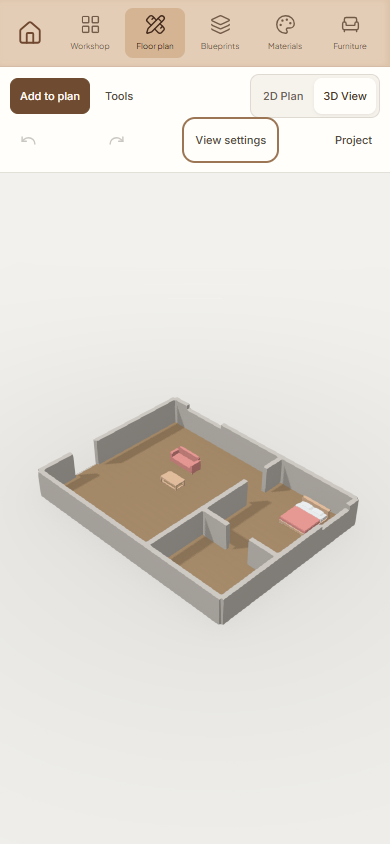
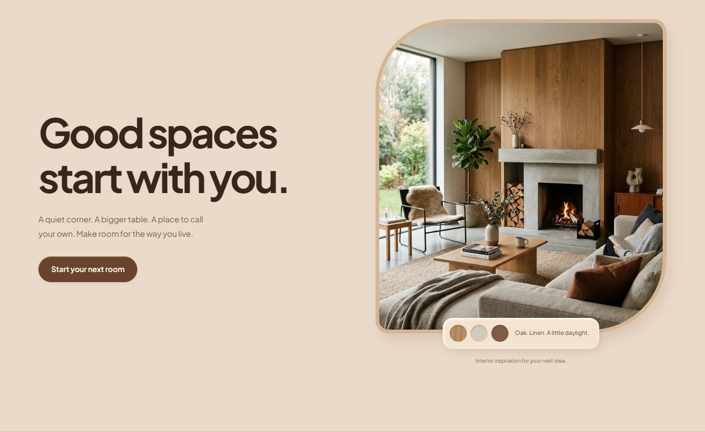

# Domus AI

Domus AI is a browser workspace for planning rooms, exploring interiors, and viewing building designs in 2D and 3D.

## Vision

Help people turn a room idea, a sketch, or a floor plan into a design they can understand and improve. Homeowners should be able to explore a space without learning complex CAD software. Designers should be able to edit layouts, compare materials, place furniture, and export useful design data from one workspace.

This is a portfolio and senior project. The main workflow runs locally in your browser. Camera measurement and original AI model generation remain experiments. A preview is not a measured survey or construction approval.

## Pictures

These are screenshots of the local app, not concept images.


The home page introduces the product and links to the workspace.


The tool selector opens the five design modules.



The floor plan editor draws walls and edits openings. No account is required. Your project stays in this browser.

## Current pages

- `/`: Product introduction and starting points.
- `/editor`: Choose a design tool.
- `/floor-plan`: Create and edit plans, place furniture, and switch between 2D and 3D. Saves changes in this browser.
- `/bim-lift`: Import a blueprint and explore a 3D building workflow.
- `/ar-map`: Experimental camera and room scanning tools. Some scan results use fixed sample geometry.
- `/material-lab`: Explore finishes and material previews.
- `/furniture`: Place furniture and try model generation. Without a provider, the API returns a catalog model.
- `/dashboard`: List projects, filter by type, and open project tools.
- `/settings`: A local profile with a name and project notes. Changes persist in this browser.
- `/community`: Your local project gallery. It does not publish projects online.
- `/community/<projectId>`: Shows saved plan geometry and can create a separate editable copy.
- `/login` and `/onboarding`: An open workshop entry page and optional first-use setup.
- `/showcase`, `/pricing`, `/about`, `/blog`, `/changelog`, and `/contact`: Product information. The contact form downloads a message draft and does not claim to send it.
- `/privacy`, `/terms`, `/cookies`, and `/gdpr`: Policy pages.

## Current features

- Editor state for floor plans, scene objects, storeys, stairs, and dimensions.
- 2D drawing and 3D viewing with walls, doors, windows, roofs, and furniture.
- Furniture models bundled with the app.
- Calibrated blueprint references, automatic wall tracing, room detection at wall intersections, and snapping.
- A versioned project document with explicit units and one save path across the tools.
- Material selection and texture previews.
- Bill of materials calculations and export code for PDF, DXF, and IFC.
- Browser-local projects, preferences, and immediate floor plan saving.
- AI service routes with provider-based or sample fallback behavior.

No sign-in is required. Projects stay in this browser, so export a copy before clearing browsing data. Shared editing is disabled. Camera tracking and room scans are labeled demonstrations. Material planning exports estimates as CSV without placing orders. Live image-to-3D generation uses server-side polling, but still needs validation with a configured provider. It is disabled by default. Set ENABLE_PAID_GENERATION=true only after setting up provider access and a durable usage limit.

## Run locally

Use Node.js 20.9 or newer and npm. A current Node LTS release is preferred.

```sh
npm ci
```

Copy `.env.example` to `.env.local`. Keep real keys out of Git. Set `NEXT_PUBLIC_URL` to `http://localhost:3001` for local work. Server AI routes read provider keys where implemented. There is no browser account SDK. Missing keys can select sample output instead of live generation.

```sh
npm run dev
```

Open [localhost:3001](http://localhost:3001).

```sh
npx tsc --noEmit
npm run lint
npm test
npm run build
npm run start
```

The production server also uses port 3001. Stop the development server before starting it.

## Review and next steps

Read the [fix status and remaining work](docs/fix-status.md) for completed fixes and the larger items that still need decisions. The [original review](docs/product-review.md) is a historical baseline.

To repeat the read-only browser review, start the production server and run:

```powershell
$env:REVIEW_URL = "http://127.0.0.1:3001"
node scripts/review-smoke.mjs
```

The script uses installed Microsoft Edge. Set `REVIEW_BROWSER=chromium` to use an installed Playwright Chromium browser. It writes screenshots and page results under `docs/`.

## Portfolio demonstration

Open the workshop and choose **Explore a furnished example**. It creates a separate project with a living space, bedroom, bathroom, openings, and furniture. Try undo and redo, switch to 3D, change a finish, and download a PDF plan sheet or DXF drawing.

See the [issue difficulty table](docs/portfolio-issues.md) for fixes and the remaining features above difficulty 5. Accounts, payments, and supplier ordering are outside this student project scope.

The material lab matches built-in finishes. Blueprint tracing includes a clean sample, two-point scale calibration, and a saved image reference for manual drawing. Automatic tracing detects simple wall lines. You add doors, windows, and room uses yourself. Imported furniture uses self-contained GLB files up to 2 MB so it can survive a reload.

Run `node scripts/verify-portfolio.mjs` against a production preview on port 3112. Set REVIEW_URL to test another port. The script writes example exports and its results under docs/portfolio-verification.


## Why the software changed

The main problems came from separate save paths, room detection that expected every wall junction to be split, and imports that guessed missing details. The editor now captures one versioned document, derives rooms from connected wall geometry, and requires a measured reference for blueprint scale. IFC doors and windows now link to real wall openings, checked with an independent IFC reader.

Read the [architecture comparison and root fixes](docs/architecture-root-fixes.md) for the reasoning, comparisons with established software, and remaining limits.




## Reviewed editor

The editor has one top toolbar, an Add to plan catalog, and a View settings panel. Switch between 2D and 3D without navigating away. The 3D preview starts with bright studio lighting and lowered walls so the furniture is visible. Lowered walls are a viewing option. The saved wall dimensions stay unchanged.







Layout alternatives contain different geometry. Generated plans are checked for overlapping rooms and basic circulation connections before use. AI blueprint coordinates are converted using your measured scale. All model entry points wait for a finished result, and failed model loads show a visible error.

Optional live model generation requires REPLICATE_API_KEY, ENABLE_PAID_GENERATION=true, and REPLICATE_TRELLIS_VERSION from the [documented firtoz/trellis images-input model](https://replicate.com/firtoz/trellis/api/schema). Catalog searches remain local when a provider is configured. OPENAI_API_KEY enables optional layout and calibrated blueprint analysis. No provider keys are configured in the reviewed local setup, so real AI output quality is not yet verified.

See the [current issue table](docs/portfolio-issues.md#follow-up-fixes-and-final-review) for the final verification scope and remaining device, recognition, and CAD work.


The latest follow-up checks floor copying, furniture on separate floors, stair connections, deletion with undo, and a two-floor IFC file opened by an independent reader. The bundled blueprint traces into six walls and survives a save and reload. See [the verification record](docs/portfolio-verification/multi-floor-bim.json). IFC export currently includes walls, doors, windows, and rectangular slabs. Furniture, stairs, stair openings, and exact irregular slab outlines are not yet included.


