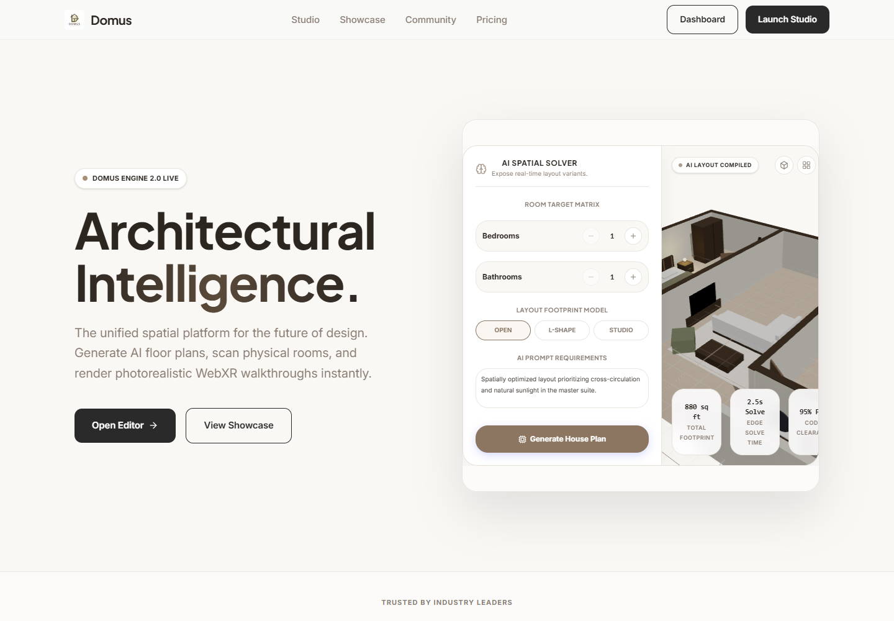
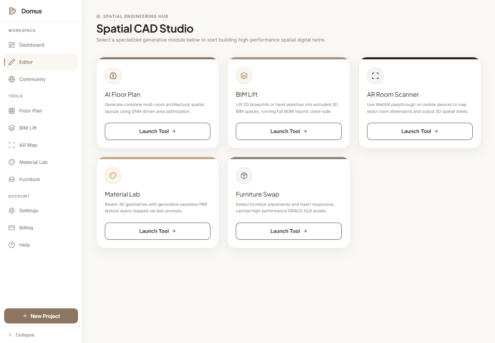

# Domus AI

Domus AI is a browser workspace for planning rooms, exploring interiors, and viewing building designs in 2D and 3D.

## Vision

Help people turn a room idea, a sketch, or a floor plan into a design they can understand and improve. Homeowners should be able to explore a space without learning complex CAD software. Designers should be able to edit layouts, compare materials, place furniture, and export useful design data from one workspace.

This is an early product. The core editor exists, while several cloud, scanning, and shopping flows still need work. A preview is not a measured survey or construction approval.

## Pictures

These are screenshots of the local app, not concept images.



The home page introduces the product and links to the workspace.



The tool selector opens the five design modules.


The floor plan page starts the design workflow. Cloud loading and account access can affect readiness.

## Current pages

- `/`: Product introduction and starting points.
- `/editor`: Choose a design tool.
- `/floor-plan`: Create and edit plans, place furniture, and switch between 2D and 3D. Includes local backup and cloud save code.
- `/bim-lift`: Import a blueprint and explore a 3D building workflow.
- `/ar-map`: Experimental camera and room scanning tools. Some scan results use fixed sample geometry.
- `/material-lab`: Explore finishes and material previews.
- `/furniture`: Place furniture and try model generation. Without a provider, the API returns a catalog model.
- `/dashboard`: List projects, filter by type, and open project tools.
- `/settings`: Profile and account interface. Saving currently uses a timer without persisting changes.
- `/community`: Community interface. Public sharing needs a verified access model.
- `/<projectId>`: Project detail viewer. Also catches unknown single-part URLs.
- `/login` and `/onboarding`: Account entry and first-use setup.
- `/showcase`, `/pricing`, `/about`, `/blog`, `/changelog`, and `/contact`: Product information. The contact form shows sample success without sending a message.
- `/privacy`, `/terms`, `/cookies`, and `/gdpr`: Policy pages.

## Current features

- Editor state for floor plans, scene objects, storeys, stairs, and dimensions.
- 2D drawing and 3D viewing with walls, doors, windows, roofs, and furniture.
- Furniture models bundled with the app.
- Blueprint processing, room detection, snapping, and geometry helpers.
- Material selection and texture previews.
- Bill of materials calculations and export code for PDF, DXF, and IFC.
- Puter account, storage, and project helpers, plus local floor plan backups.
- AI service routes with provider-based or sample fallback behavior.

Availability varies. Camera access, cloud saves, paid generation, shared editing, procurement, and cross-account publishing need further validation. Collaboration currently joins one public room. Disable or isolate it before using private designs.

## Run locally

Use Node.js 20.9 or newer and npm. A current Node LTS release is preferred.

```sh
npm ci
```

Copy `.env.example` to `.env.local`. Keep real keys out of Git. Set `NEXT_PUBLIC_URL` to `http://localhost:3001` for local work. Server AI routes read provider keys where implemented. Puter runs in the browser and may require account access. Missing keys can select sample output instead of live generation.

```sh
npm run dev
```

Open [localhost:3001](http://localhost:3001).

```sh
npx tsc --noEmit
npm run lint
npm test
npm run build
npm run start
```

The production server also uses port 3001. Stop the development server before starting it.

## Review and next steps

Read the [developer and user review](docs/product-review.md) for confirmed issues, proposed fixes, checks, and testing limits.

To repeat the read-only browser review, start the production server and run:

```powershell
$env:REVIEW_URL = "http://127.0.0.1:3001"
node scripts/review-smoke.cjs
```

The script uses installed Microsoft Edge. Set `REVIEW_BROWSER=chromium` to use an installed Playwright Chromium browser. It writes screenshots and page results under `docs/`.
