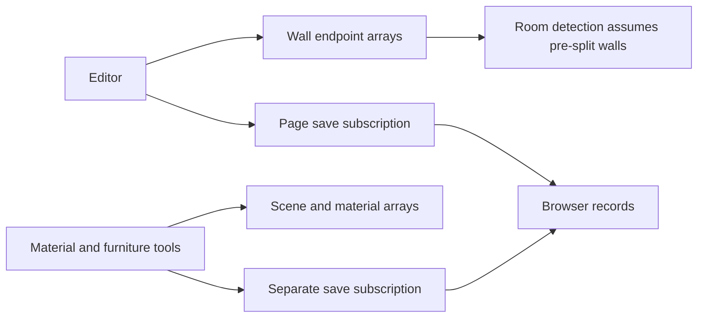
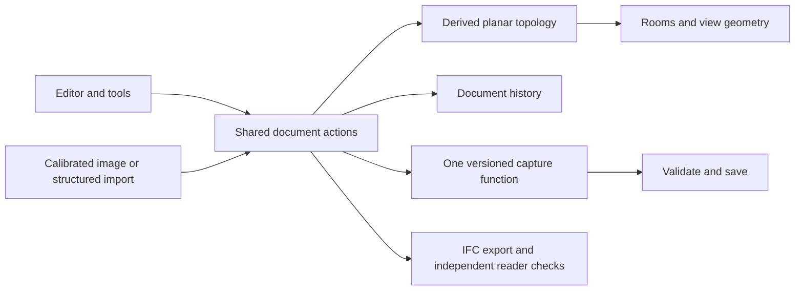

# Architecture comparison and root fixes

This review treats Domus as a portfolio and senior project. It compares specific design choices using public documentation. Established software also has bugs. The comparison does not assume that those tools solve every input or device automatically.

## Why the same symptoms kept returning

Domus grew around individual feature pages. The editor, material tool, imports, and exporters each made some of their own decisions about geometry, active projects, or saving. Fixing one page could leave another path with different assumptions. The most important change is to move those rules below the interface.

## Shared document instead of page-owned state

Sweet Home 3D exposes a Home model and plan controllers whose wall, room, and furniture operations create undoable edits. Open CASCADE's OCAF framework uses document transactions with commit and abort, including undo. These are examples of keeping editing semantics with the document. Sources: [Sweet Home 3D PlanController](https://www.sweethome3d.com/javadoc/com/eteks/sweethome3d/viewcontroller/PlanController.html), [Open CASCADE OCAF](https://occt3d.com/dev/doc/overview/html/occt_user_guides__ocaf.html).

Our confirmed problem was two separate save subscriptions assembling snapshots differently. Material definitions and the active storey were easy to leave out. Undo restored design fields while the cached quantity analysis could describe a later design.

Implemented:

- One persistence adapter for editor and side tools.
- One capture function for the active plan, all storeys, furniture, materials, stairs, and dimensions.
- A versioned document boundary with declared units: plan coordinates in feet, openings in inches, scene positions in metres. This preserves compatibility while making the mixed unit convention explicit.
- Validation at save and load boundaries. Invalid geometry, dangling opening references, duplicate wall IDs, and unknown document versions are refused. Unknown records remain on disk without being rewritten.
- Failed writes remain dirty and can be retried on the next state change.
- Document undo and redo refresh derived quantities without creating extra undo steps.

This is a shared document boundary and save adapter. It is not a claim that every large component has been replaced by a full command architecture.

## Connected geometry instead of convenient endpoints

Our old room detector treated only wall endpoints as graph vertices. A partition meeting the middle of a wall did not connect unless the UI or fixture had already split that wall. Increasing the snap distance could hide that error while closing real gaps. The earlier sample-specific wall splitting was a symptom fix.

Implemented a pure, derived topology builder:

- Split graph edges at actual intersections and T junctions.
- Handle overlapping or reversed duplicate segments without counting extra rooms.
- Preserve the original wall IDs and opening positions. The graph does not destructively split source walls.
- Use a small topology tolerance separate from the user's magnetic snap radius.
- Build room polygons from the graph and render those polygons directly.
- Detect small closed spaces rather than dropping closets under the old area cutoff.
- Route plan replacement through the store's room derivation rather than relying on each page to prepare valid rooms.

Tests cover unsplit partitions, crossings, reversed wall direction, duplicate segments, overlaps, real gaps, and small closets. The pairwise graph builder is appropriate for the current project size. A spatial index or worker would be a later performance improvement for large drawings.

## Blueprint recognition is a different problem from drawing

Sweet Home 3D documents a practical workflow: import an image, calibrate a line of known length, establish its origin, and draw walls over it. It does not require an arbitrary image to become a complete correct building automatically. Source: [Sweet Home 3D user guide](https://www.sweethome3d.com/users-guide/).

Our automatic tracer used raster thresholds and line clustering, then guessed room extents and openings. That cannot establish the meaning of every symbol, dimension, or messy sketch. Full-image width was also a poor calibration reference when an image had margins.

Implemented:

- Two selected image points plus their known real length establish scale.
- Keyboard users can enter the pixel coordinates directly.
- A manual tracing workflow opens that calibrated image behind the editor grid.
- The image is embedded in the project, downsampled with its scale adjusted, and bounded in size. Reloading does not depend on a temporary browser URL.
- Automatic wall extraction remains available as an optional aid. The reliable path is calibrated manual tracing and review.

Reliable recognition of arbitrary drawings remains a separate image-understanding problem. The new tracing workflow lets the project work without pretending that problem is solved.

## IFC needs model semantics and independent readers

A file containing strings such as IFCWALL is not enough evidence of interoperability. IFC tools such as IfcOpenShell provide schema and rule validation, separate from simply generating text. Source: [IfcOpenShell validation documentation](https://docs.ifcopenshell.org/autoapi/ifcopenshell/validate/index.html).

Our earlier tests mainly checked whether expected entity names appeared in the output. The exporter could describe a door and still leave the wall solid.

Implemented:

- Real opening elements and void relationships to their parent walls.
- Fill relationships for the corresponding doors and windows.
- Correct 128-bit IFC identifier encoding, quoted storey names, and zero sill-height handling.
- Wall thickness and height retain their actual values instead of being silently enlarged by arbitrary minimums.
- Regression exports are opened and their wall geometry is generated with the independent web-ifc reader already installed in the project.

This is stronger evidence than text matching. It does not establish full EXPRESS-rule compliance or compatibility with every CAD application. External round trips remain a separate acceptance check.

## Real room scanning needs a capture pipeline

Apple RoomPlan combines ARKit, camera and LiDAR data, trained models, scan guidance, and a parametric output. Its documentation also lists limits and difficult scanning conditions. Source: [Apple RoomPlan](https://developer.apple.com/augmented-reality/roomplan/), [RoomPlan capture guidance](https://developer.apple.com/videos/play/wwdc2022/10127/).

Our camera preview and sample room contain no comparable measurement pipeline. A nicer point cloud or more animation cannot supply missing depth measurements. A real version would need supported capture hardware and a native or supported sensor integration, followed by an adapter into the document model. That remains open. The existing sample mode stays labeled as a demonstration.

## Original AI models and touch editing

An AI provider is an inference dependency, not a geometry feature supplied by React. Server-side job handling and explicit catalog fallback solve request lifecycle problems; they do not replace a missing provider, trained model, or quality evaluation.

Touch editing similarly needs explicit interaction states, cancellation, and gesture transactions. The shared document and persistence layers reduce the chance that a gesture is lost or changes another project. Complex touch gestures and multi-storey acceptance testing remain additional work.

## Resulting direction

The next large refactor, if needed, is to move more gesture and selection logic out of the large canvas component into document commands and separate view controllers. It should be done incrementally with the existing browser walkthrough kept passing, rather than replacing the entire application at once.

## Verification and remaining scope

The software regression suite has 55 passing tests. It covers wall junctions, crossing partitions, real gaps, small closed rooms, version migration, invalid documents, save retries, undo quantity updates, calibration, and IFC relationships through the independent reader.

The browser walkthrough checks the furnished example, edits and history, finishes, furniture import and reload, PDF/DXF downloads, gallery, blueprint import, supporting pages, and mobile controls. A separate manual reference check verifies the measured scale and saved image after reload. Evidence is under [portfolio-verification](portfolio-verification/).

Automatic tracing no longer adds guessed doors or windows. New detected rooms start as Unassigned. Image size never substitutes for a known measurement. The unsupported building-code compliance badge was removed. The trace score remains a simple heuristic, not an accuracy percentage established from a dataset.

The remaining substantial work is real device measurement, arbitrary blueprint recognition, live AI model quality, selected CAD round trips, and full touch drafting. These need scoped acceptance criteria or hardware choices. The current fixes make the demonstrated path more coherent; they do not prove those research features are solved.

The optimized build passes. It retains the existing Edge static-generation notice and XR CommonJS/ES module notice. These notices do not establish a failure in the tested browser workflow. The same-version React Doctor regression score remains 46/100; the latest scanner reports 57/100 with a different rule set. Remaining diagnostic findings are recorded separately from verified task failures.

## Editor and feature follow-up

The follow-up removes misleading controls and unifies their behavior. A single model client now handles finished results, pending jobs, failure, cancellation, and explicit catalog samples across every entry point. A shared layout generator validates overlap and circulation, while the geometry compiler derives real shared and exterior boundaries. Alternative selection applies returned geometry rather than invented scores. Image recognition is normalized through the measured pixel scale instead of a residential-size assumption.

The workspace now has one primary command bar and grouped view settings. Generated local lighting uses the documented [Drei environment](https://drei.docs.pmnd.rs/staging/environment) and [Lightformer](https://drei.docs.pmnd.rs/staging/lightformer) APIs. A view-only wall cutaway reveals furniture while preserving the document. A client external store uses [React useSyncExternalStore](https://react.dev/reference/react/useSyncExternalStore) to keep headset initialization consistent during hydration.

The revised source has 77 passing tests. The final issue report separates verified software behavior from live AI quality, physical headset capability, and wider CAD round trips.
